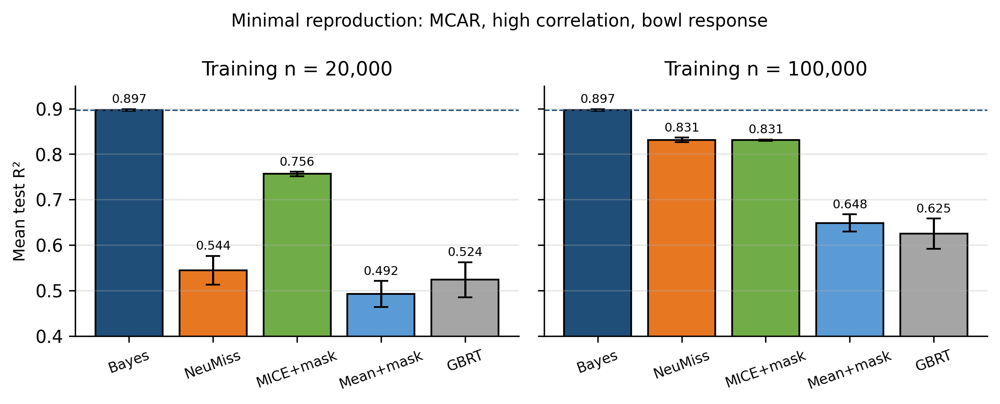

# What's a Good Imputation to Predict with Missing Values? Paper summary and reproduction

Le Morvan, Josse, Scornet, and Varoquaux (NeurIPS 2021)

# Part I. Paper summary

## 1. Main problem addressed
*(Paper: Abstract, Sections 1 and 2)*

The paper studies supervised prediction when some input variables are missing. A common workflow first imputes the absent entries and then fits a standard predictor, but the statistical validity of this approach was not well understood beyond restrictive missing-data assumptions. The paper asks when impute-then-regress can reach the Bayes risk, whether good reconstruction of missing covariates is required for good prediction, and how the chosen imputation changes the difficulty of the downstream learning problem.

## 2. Proposed solution
*(Paper: Section 3 / Theorem 3.1, Sections 4 and 5)*

The authors provide a general consistency result for impute-then-regress. For almost every continuously differentiable imputation rule, a universally consistent learner trained on the completed data is Bayes consistent, including under non-random missingness. The paper then argues that asymptotic correctness is not enough for finite samples because some imputations create a difficult or discontinuous regression function. To address this practical issue, it proposes learning imputation and regression jointly through NeuMiss+MLP, where a differentiable NeuMiss block is trained together with a multilayer perceptron for the prediction objective.

## 3. Optimizations and special cases
*(Paper: Section 3 remark on classification, Sections 4.1 to 4.3, Section 6.1)*

The NeuMiss block uses shared weights across its layers, so a depth of 20 adds no extra parameters, and it includes residual connections. Model depth, width, learning rate, and weight decay are selected on validation data, and training uses Adam with a learning-rate reduction on plateau and early stopping. On the theoretical side, the paper shows that plugging conditional-mean imputations into the true regression function is generally not Bayes optimal when that function is curved, with an excess risk that grows with curvature and with the conditional variance of the missing entries. In the linear special case the curvature is zero, so this chained approach is exactly optimal. The paper also shows that the best regressor on conditionally imputed data is generally discontinuous, and that "corrected" imputations can themselves need discontinuities. The consistency argument is extended to binary classification.

## 4. Strengths and limitations
*(Paper: Section 3, Section 6.2, Section 7)*

The main strength is the breadth of the consistency result: it does not depend on a MAR assumption, a particular imputation family, or a single missing variable. The paper also clearly separates accurate covariate reconstruction from accurate outcome prediction. Its key limitation is that the strongest result is asymptotic and does not determine which imputation is easiest to learn from limited data; the authors themselves list finite-sample theory as future work. The empirical evidence is based on controlled synthetic regression experiments with Gaussian covariates, so additional evidence is needed for real datasets, other distributions, and classification tasks.

## 5. Evaluation methodology
*(Paper: Section 6.1, Figures 3 and 4, Appendix B)*

The experiments use 50-dimensional Gaussian covariates with a low-rank-plus-diagonal covariance, in a high-correlation setting (rank 0.3d) and a low-correlation setting (rank 0.7d). Half of the entries are removed under MCAR or Gaussian self-masking (MNAR). Three nonlinear response functions are used (bowl, wave, break), with a signal-to-noise ratio of 10. The study compares Bayes and oracle references (Bayes predictor, chained oracles, oracle imputation + MLP), NeuMiss+MLP, mean and MICE imputation with MLP (with and without the mask), and gradient-boosted trees. Training sets have 100,000 rows, validation and test sets 10,000 rows, and each method is scored by its test R² minus the Bayes predictor's R² over 10 repetitions (Figure 4).

# Part II. Reproduction of the main experiment

## 1. Experiment and code
I reproduced the MCAR / high-correlation / bowl setting of Figure 4 using the authors' public implementation, so no reimplementation was needed. The authors' data generator, estimators, NeuMiss+MLP model, Bayes predictor and experiment runner (`run_all.run`) were used unchanged, except that `np.Inf` was replaced by `np.inf` in `pytorchtools.py`, because NumPy 2 removed the old alias. I wrote a short driver script that calls the authors' code with the reduced configuration below. To keep computation small, I used one fixed hyperparameter setting per method, three repetitions and five methods, at the paper's training size (100,000) and at 20,000 for comparison.

**Code:** the algorithm and experiment code are the authors' implementation at https://github.com/marineLM/Impute_then_Regress (commit `37e70a33`). My own driver script (sets the reduced experiment configuration and runs it), results-analysis script and Databricks notebook are at https://github.com/Ehab4tbi/Impute-then-Regress-Reproduction

## 2. Parameter settings

| **Parameter** | **Paper (Figure 4)** | **Used here** |
| --- | --- | --- |
| Missingness / response | MCAR, GSM / bowl, wave, break | MCAR / bowl (`link='square'`, `curvature=1`) |
| Features / missing rate / SNR | 50 / 0.5 / 10 | same |
| Correlation (`prop_latent`) | 0.3 (high), 0.7 (low) | 0.3 (high) |
| Training size | 100,000 | 100,000 and 20,000 |
| Validation / test size | 10,000 / 10,000 | same; validation split 5,000 model selection + 5,000 early stopping (`run_all.run_one`) |
| Repetitions / seeds | 10 | 3; data seed = repetition index (0, 1, 2), `torch.manual_seed(0)` |
| MLP (all MLP methods) | depth 1/2/5, width 1d/5d/10d, learning rate 5e-4 to 1e-2, weight decay 1e-6 to 1e-3 (validation search) | depth 2, width 5d, learning rate 1e-3, weight decay 1e-5; Adam, batch 100, max 1,000 epochs, early stopping |
| NeuMiss + MLP | depth 20, shared weights, residual connection | same, no mask |
| Mean / MICE + mask + MLP | mean or IterativeImputer, mask concatenated | same |
| GBRT | Paper: leaves 50 to 600, iterations 100 to 300, min leaf 10 to 50. Repository grid: {50, 100, 200, 400, 600} x {100, 200, 300} x {10, 20, 50} | 200 leaves, 300 iterations, min leaf 20, `n_iter_no_change=10` |
| Not run | | chained oracles, oracle + MLP, unmasked mean/MICE + MLP |
| Software / compute | | Python 3.12.3, NumPy 2.3.4, pandas 2.3.3, SciPy 1.16.3, scikit-learn 1.7.2, PyTorch 2.11.0; Databricks Serverless GPU; N_JOBS = 18 |

## 3. Results

| **Method** | **n train** | **Test R², mean (SD)** | **ΔR² vs Bayes, mean (SD)** |
| --- | --- | --- | --- |
| Bayes predictor | 100,000 | 0.8968 (0.0020) | 0 |
| NeuMiss + MLP | 100,000 | 0.8311 (0.0051) | -0.0657 (0.0057) |
| MICE + mask + MLP | 100,000 | 0.8307 (0.0013) | -0.0661 (0.0030) |
| Mean + mask + MLP | 100,000 | 0.6485 (0.0188) | -0.2483 (0.0186) |
| GBRT | 100,000 | 0.6249 (0.0335) | -0.2719 (0.0334) |
| Bayes predictor | 20,000 | 0.8968 (0.0020) | 0 |
| MICE + mask + MLP | 20,000 | 0.7563 (0.0050) | -0.1405 (0.0069) |
| NeuMiss + MLP | 20,000 | 0.5444 (0.0318) | -0.3523 (0.0329) |
| GBRT | 20,000 | 0.5236 (0.0388) | -0.3732 (0.0390) |
| Mean + mask + MLP | 20,000 | 0.4923 (0.0287) | -0.4044 (0.0279) |

ΔR² = method test R² minus Bayes test R², per repetition (a difference, not a ratio); SD over 3 repetitions. The Bayes predictor uses the true parameters and the same test set at both sizes, so its score is identical.

## 4. Discussion

**Comparison with the paper.** The paper reports Figure 4 graphically rather than in a numerical table, so I compare method ordering and qualitative findings rather than exact values. Among the practical methods included, the pattern at 100,000 rows is broadly consistent with the paper: NeuMiss + MLP and MICE + mask + MLP are strongest, while mean + mask + MLP and GBRT are substantially farther from the Bayes reference, and all methods stay below it. The paper's claim that NeuMiss + MLP is the best method was not confirmed: its mean test R² differed from MICE + mask + MLP by only 0.0004, and three repetitions give insufficient evidence that either is superior. The full Figure 4 ranking was not reproduced because oracle and unmasked baselines were omitted. At 20,000 rows MICE + mask + MLP scored highest, and NeuMiss + MLP improved strongly between the two sizes (ΔR² from -0.352 to -0.066). This is an observed pattern; two sizes and three repetitions are not enough for a general learning-curve conclusion.

**Possible reasons for differences.**
1. **No hyperparameter search.** The paper selects each method's best configuration on validation data; I used one fixed setting. NeuMiss + MLP, which learns imputation and regression together, may be more sensitive to this.
2. **Setting.** The high-correlation setting, which the paper calls "easy", may favour conditional imputation such as MICE. This is a plausible explanation, not something this experiment proves. Low correlation, self-masking, wave and break were not run.
3. **Fewer repetitions.** Three repetitions instead of ten make small differences impossible to separate.
4. **Software and randomness.** Library versions are newer than in 2021. GBRT has no fixed `random_state` in the authors' code, and its early stopping draws a random split, so its score changes slightly between runs (0.5268 in an earlier 20,000-row run, 0.5236 in the final run).
5. **Neutral changes.** The `np.Inf` edit and parallel execution (18 jobs, one thread each) do not change the algorithm.

**Conclusion.** With a minimal compute budget, the authors' pipeline reproduced the main qualitative result for the selected setting. NeuMiss + MLP (joint imputation and regression) and MICE + mask + MLP get much closer to the Bayes predictor than mean imputation or gradient-boosted trees. NeuMiss being strictly best was not confirmed in this reduced run.

# References
Le Morvan, M., Josse, J., Scornet, E., & Varoquaux, G. (2021). What's a Good Imputation to Predict with Missing Values? Advances in Neural Information Processing Systems 34.

marineLM/Impute_then_Regress, GitHub repository, commit 37e70a33fb60330b6d4f95173d202a58135d0dae.
